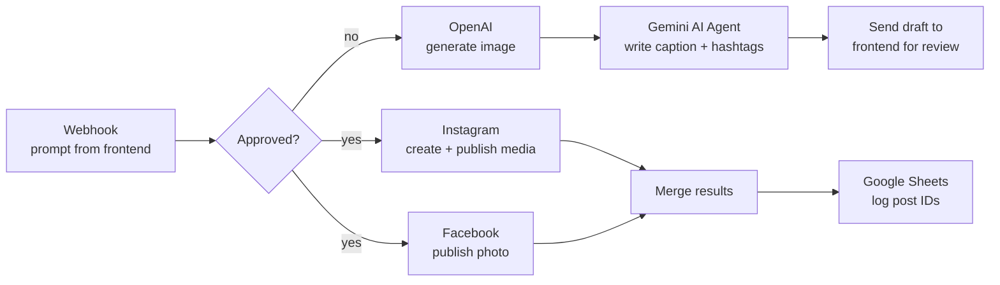
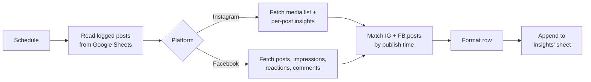
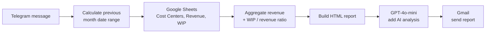

# n8n Automation Workflows

Business automation workflows I built with [n8n](https://n8n.io) during my internship at **Arkhetech Software GmbH** (Bremen, Jun–Aug 2025). They combine generative AI (OpenAI, Google Gemini) with Google Sheets, Gmail, Telegram and the Meta Graph API to automate social media and financial reporting.

All API keys, account IDs, sheet IDs and email addresses have been removed. See [Setup](#setup) to run them yourself.

| Workflow | What it automates | Main tools |
| --- | --- | --- |
| [Social Media Publisher](workflows/social-media-publisher.json) | AI-generated posts with an approval step, published to Instagram and Facebook | OpenAI (images), Gemini, Meta Graph API, Google Sheets |
| [Social Media Insights](workflows/social-media-insights.json) | Collects performance metrics for every published post | Meta Graph API, Google Sheets |
| [AI Financial Report](workflows/ai-financial-report.json) | Monthly financial report with AI commentary, sent by email | Google Sheets, OpenAI GPT-4o-mini, Gmail, Telegram |

---

## 1. Social Media Publisher

Turns a single text prompt into a ready-to-publish social media post, lets a person review it, then publishes it to several platforms at once.

**How it works**

1. A web frontend sends a prompt to the webhook.
2. **Draft step:** OpenAI generates an image, and an AI agent running on Gemini writes a short caption with hashtags and emojis. The draft is sent back to the frontend for preview.
3. **Approval step:** when the user approves the draft, the frontend calls the webhook again with `action: "onayla"` ("approve" in Turkish).
4. The post is published to **Instagram** (two-step create + publish via the Graph API) and **Facebook** at the same time. A LinkedIn branch is prepared but disabled.
5. The post IDs from each platform are logged to Google Sheets with a shared group ID, so the Insights workflow can track them later.

---

## 2. Social Media Insights

Runs on a schedule and measures how the published posts are performing.

**Metrics collected**

- **Instagram:** reach, views, likes, comments, saves, shares, total interactions
- **Facebook:** impressions, reactions, comments

Because one piece of content is published to both platforms at the same time, the workflow matches the Instagram and Facebook versions by their publish time (to the minute) and saves them as one row. That gives a single cross-platform view of each post.

---

## 3. AI Financial Report

Generates a formatted financial performance report on request and emails it, with a short analysis written by an LLM.

**How it works**

1. Sending a message to a Telegram bot triggers the workflow.
2. A code step calculates the first and last day of the previous month.
3. Data is read from three Google Sheets tabs (Cost Centers, Revenue, Work in Progress). Revenue is aggregated per cost center and merged with WIP to calculate the **WIP-to-revenue ratio**.
4. A code step builds an HTML email with an executive summary, budget vs. actual (variance), business unit performance and recommendations.
5. An AI agent (GPT-4o-mini) reads the report and appends a 2–3 sentence **"AI Analysis"** paragraph.
6. The final report is sent via Gmail.

> **Note:** This was built as a prototype on a demo dataset. The budget figure, business unit table and recommendations are sample values in the code; revenue and WIP come from the sheet.

---

## Setup

1. In n8n, go to **Workflows → Import from File** and select a JSON file from [`workflows/`](workflows).
2. Create credentials in n8n for the services each workflow uses (OpenAI, Google Gemini, Google Sheets, Gmail, Telegram, Facebook Graph API) and select them in the matching nodes.
3. Replace the placeholders:

| Placeholder | Replace with |
| --- | --- |
| `YOUR_SOCIAL_LOG_SHEET_ID` | Google Sheet used to log posts (tabs: `ig`, `insights`) |
| `YOUR_FINANCE_SHEET_ID` | Google Sheet with `CostCenters`, `Revenue` and `WIP` tabs |
| `YOUR_FACEBOOK_PAGE_ID` | Your Facebook Page ID |
| `YOUR_INSTAGRAM_ACCOUNT_ID` | Your Instagram Business account ID |
| `https://your-frontend.example.com/...` | Your review frontend endpoint |
| `reports@example.com` | Report recipient |

4. Set the `META_ACCESS_TOKEN` environment variable in n8n for the Insights workflow.

## Skills Demonstrated

- Workflow automation and process design in n8n
- Generative AI integration (OpenAI image generation, Gemini, GPT-4o-mini agents)
- REST API integration (Meta Graph API for Instagram and Facebook)
- Data processing and aggregation in JavaScript
- Human-in-the-loop approval flows
- Automated reporting with Google Sheets, Gmail and Telegram

## Author

**Rauf Mammadli**: [GitHub](https://github.com/raufmmdly87) · [LinkedIn](https://www.linkedin.com/in/rauf-mammadli-183a71304)
